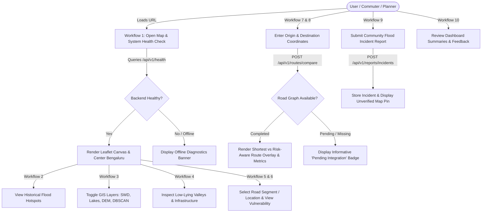

# FloodLens — User Workflows Specification

> **Document Status:** Phase 0 Baseline  
> **Lead Owner:** Person B (UI/Dashboard & Routing Integration Lead)  
> **Secondary Reviewer:** Person A (Interactive Map & System Architecture Lead)  
> **Target Audience:** Citizens, Urban Planners, Municipal Engineers, Emergency Responders  
> **Safety Advisory Notice:**  
> Routes presented in FloodLens are comparative risk estimates based on mapped historical observations, infrastructure proximity, and topographical models. They **do not constitute guaranteed flood-free or safe transit clearance**. Users must adhere to on-ground traffic authorities, emergency services, and live weather alerts.

---

## 1. System Interaction Architecture

The FloodLens web interface couples a Leaflet-based interactive cartographic canvas (Person A) with an analytical sidebar dashboard and routing panel (Person B).



---

## 2. Detailed User Workflows

---

### Workflow 1: Open the FloodLens Map
- **User Action:**  
  User navigates to the FloodLens web application URL (e.g., `http://localhost:5173` in local development).
- **System Response:**  
  1. Frontend boots React application and executes startup health check via `GET /api/v1/health`.
  2. Initializes Leaflet cartographic map container centered over central Bengaluru (Vidhana Soudha / MG Road coordinates: `[12.9716, 77.5946]`, default zoom level `12`).
  3. Loads base cartography (CartoDB Dark/Positron or OpenStreetMap standard tiles).
  4. Header displays system identity, version (`0.1.0`), and real-time backend operational status badge.
- **Required Data:**  
  - Leaflet base map tiles.
  - Endpoint `GET /api/v1/health` payload: `status`, `study_area`, `crs` definitions (`EPSG:4326`, `EPSG:32643`).
- **Expected Output:**  
  - Full-height interactive map loaded with zoom controls and coordinate scale.
  - Green "System Healthy" badge in header (or yellow/red if disconnected).
  - Sidebar panel rendered on the right containing vulnerability cards and routing controls.
- **Error or Unavailable-Data Behaviour:**  
  - If backend is offline or unreachable: A non-blocking amber alert banner is displayed at the top: *"Backend Service Offline — Operating in Offline Inspection Mode"*. Base map tiles remain navigable, but analytical queries and dynamic layer fetches are paused.

---

### Workflow 2: View Historical Flood Locations
- **User Action:**  
  User navigates the map or ensures the "Historical Flood Points" toggle is enabled in the map layer controller.
- **System Response:**  
  1. Frontend fetches GeoJSON feature collection from `GET /api/v1/floods/points`.
  2. Parses point features and renders circular markers on the Leaflet canvas.
  3. Clicking any individual marker opens an inspection popup.
- **Required Data:**  
  - Endpoint `GET /api/v1/floods/points`.
  - Point attributes: `id`, `name`, `year`, `severity`, `source`, `cluster_id`.
  - Coordinates in `EPSG:4326`.
- **Expected Output:**  
  - Color-coded circular incident markers positioned over historical inundation coordinates.
  - Clickable popup showing landmark name (e.g., "Koramangala 80ft Road"), recorded incident year, municipal source (`BBMP / KSNDMC`), and severity tier.
- **Error or Unavailable-Data Behaviour:**  
  - During Phase 0 (when raw datasets have not yet been ingested), the backend returns:
    ```json
    {
      "layer_name": "bbmp_historical_flood_points",
      "feature_count": 0,
      "geojson": {
        "type": "FeatureCollection",
        "features": [],
        "metadata": { "status": "awaiting_raw_dataset_upload" }
      }
    }
    ```
  - The UI displays an informative toast notification: *"Historical flood layer awaiting raw dataset upload in data/raw/flood_locations/."* No synthetic points are rendered.

---

### Workflow 3: Enable or Disable Geographical Layers
- **User Action:**  
  User interacts with the floating Layer Control box located on the upper-right corner of the map canvas, checking or unchecking specific layer toggles:
  - `[x] Historical Flood Points`
  - `[x] Low-Lying Areas`
  - `[ ] Stormwater Drains (SWD)`
  - `[ ] Lakes & Streams`
  - `[ ] DBSCAN Density Clusters`
- **System Response:**  
  1. Frontend dynamically mounts or unmounts the corresponding Leaflet GeoJSON layer or TileLayer.
  2. Updates layer z-index order to maintain cartographic visibility (points over lines, lines over polygons, polygons over basemap).
  3. Dynamically updates the map legend displayed in the bottom-left corner.
- **Required Data:**  
  - Client layer state variables.
  - GeoJSON datasets for active layers cached in memory or fetched on demand.
- **Expected Output:**  
  - Immediate visual addition or removal of selected vector layers without full page reload.
  - Synchronized legend showing active color symbols (e.g., blue lines for drains, purple dots for flood points, orange shaded zones for low-lying areas).
- **Error or Unavailable-Data Behaviour:**  
  - If a requested layer has no underlying features in `data/processed/`, checking the box triggers a brief status message: *"Layer unavailable: awaiting dataset processing in Phase 1"*, and the checkbox gracefully resets or shows a disabled state with an explanatory tooltip.

---

### Workflow 4: Explore Low-Lying Areas and Infrastructure
- **User Action:**  
  User enables the `Low-Lying Areas`, `Stormwater Drains`, and `Lakes & Streams` layers, then zooms in to a specific urban basin (e.g., Challaghatta Valley or Bellandur Lake catchment).
- **System Response:**  
  1. Renders semi-transparent polygons for natural topographical depressions and lakebed buffer zones.
  2. Renders colored polyline vectors tracking arterial and secondary stormwater drains (*rajakaluves*).
  3. Highlights structural intersections where major transit roads cross open stormwater canals.
- **Required Data:**  
  - BBMP low-lying polygons (`data/raw/low_lying_areas/`).
  - BBMP stormwater drainage polyline network (`data/raw/drainage/`).
  - ATREE lake boundaries (`data/raw/water_bodies/`).
- **Expected Output:**  
  - Clear visual demarcation of hydrological vulnerability corridors.
  - Clicking a drainage segment displays canal name, hierarchy (`Primary Rajakaluve`), and width.
  - Clicking a low-lying zone displays basin name and depression classification.
- **Error or Unavailable-Data Behaviour:**  
  - If low-lying polygons contain topological self-intersections or invalid geometries, the frontend suppresses corrupted polygons and logs a warning; backend geometry validation (`make_valid`) ensures only sanitized vectors are broadcast.

---

### Workflow 5: Select a Road Segment or Geographical Location
- **User Action:**  
  User clicks directly on any visible road segment or any arbitrary geographical coordinate on the map canvas.
- **System Response:**  
  1. Map highlights the selected road edge with a glowing cyan outline.
  2. Displays a coordinate marker pin at the clicked point with exact latitude and longitude coordinates in `EPSG:4326`.
  3. Triggers an event payload to the sidebar Vulnerability Panel with the selected feature ID or coordinate pair.
- **Required Data:**  
  - Road vector feature properties (`edge_id`, `highway_type`, `length_m`).
  - Click event coordinate object `{ lat: float, lng: float }`.
- **Expected Output:**  
  - Visual focus on selected road edge.
  - Sidebar switches from general city summary to "Segment Detail View".
- **Error or Unavailable-Data Behaviour:**  
  - If the user clicks on an unmapped peripheral area outside the road network, the system places a generic point marker and displays: *"Point selected outside processed road network. Showing coordinate elevation only."*

---

### Workflow 6: View Available Vulnerability Indicators
- **User Action:**  
  With a road segment or coordinate selected, the user reviews the sidebar "Vulnerability Metrics" card.
- **System Response:**  
  1. The sidebar computes or retrieves the explainable multi-criteria score breakdown for the selected edge:
     - Distance to nearest stormwater drain ($D_e$) and 30m corridor flag.
     - Distance to nearest lake/water body ($L_e$) and 50m buffer flag.
     - Distance to nearest historical flood cluster ($F_e$).
     - Ground elevation (meters ASL) and slope gradient percentage (`slope_pct`).
     - Composite vulnerability index $V_e \in [0.0, 1.0]$.
  2. Renders a color-coded Risk Tier badge (`Low`, `Medium`, `High`) and an explainable bar chart showing each factor's percentage contribution.
- **Required Data:**  
  - Processed road attributes (`vulnerability_score`, `risk_tier`, `dist_to_drain_m`, `mean_elevation_m`, `dominant_factor`).
- **Expected Output:**  
  - Quantitative breakdown (e.g., *"Score: 0.72 — High Risk | Primary Driver: Within 25m of Primary Rajakaluve; Topographical Sink (-1.8m relative to local baseline)"*).
  - Explicit advisory note confirming this is a static vulnerability metric, not a dynamic flood depth measurement.
- **Error or Unavailable-Data Behaviour:**  
  - In Phase 0, before vulnerability scoring pipeline execution, the panel displays an informative placeholder card:
    - Elevation: `Copernicus 30m GLO-30 (Pending Processing)`
    - SWD Proximity: `BBMP Drains (Pending Feature Extraction)`
    - Status: *"Vulnerability metrics will activate once feature generation pipeline runs in Phase 1."*

---

### Workflow 7: Enter an Origin and Destination
- **User Action:**  
  User navigates to the "Risk-Aware Routing" card in the sidebar and enters travel endpoints through either:
  - *Method A (Coordinate / Place Name Input):* Types textual addresses or coordinates into the "Origin" and "Destination" text fields.
  - *Method B (Interactive Map Pin Drop):* Clicks "Set Origin on Map" and clicks the starting point on the map, then clicks "Set Destination on Map" and clicks the target point.
- **System Response:**  
  1. Places green marker pin at Origin ($\mathbf{O}$) and checkered red marker pin at Destination ($\mathbf{D}$).
  2. Validates that both points fall within the Bengaluru metropolitan sanity bounding envelope ($77.40^\circ\text{E} \le \text{lon} \le 77.85^\circ\text{E}$ and $12.75^\circ\text{N} \le \text{lat} \le 13.20^\circ\text{N}$).
  3. Enables the "Compare Routes" button.
- **Required Data:**  
  - Coordinate objects: `origin: { latitude, longitude }`, `destination: { latitude, longitude }`.
- **Expected Output:**  
  - Visual route endpoint markers rendered on the Leaflet canvas.
  - Lat/Lng coordinates populated in the input fields with clear validation feedback.
- **Error or Unavailable-Data Behaviour:**  
  - If a coordinate falls outside the Bengaluru study area: An alert appears: *"Selected point is outside the Bengaluru study area boundary (77.40°E–77.85°E, 12.75°N–13.20°N). Please select a location within Bengaluru."* The "Compare Routes" button remains disabled.

---

### Workflow 8: Compare Shortest-Distance and Risk-Weighted Routes
- **User Action:**  
  User clicks the "Compare Routes" button.
- **System Response:**  
  1. Frontend submits a `POST` request to `/api/v1/routes/compare` with payload:
     ```json
     {
       "origin": { "latitude": 12.9767, "longitude": 77.5713 },
       "destination": { "latitude": 12.9719, "longitude": 77.6412 },
       "profile": "compare"
     }
     ```
  2. Backend identifies nearest road graph nodes for origin and destination in `EPSG:32643`.
  3. Executes dual route evaluation:
     - Shortest route via Dijkstra minimizing standard metric edge lengths.
     - Risk-aware route via Dijkstra minimizing risk-penalized impedance $w_e = \text{length}_e \cdot (1.0 + \alpha \cdot V_e^\beta)$.
  4. Returns comparative geometry and metrics payload.
  5. Frontend renders two distinct polyline paths on the Leaflet map:
     - Blue solid line: Shortest path.
     - Emerald/Green dashed line: Risk-aware alternative.
  6. Sidebar displays comparative tradeoff card:
     - $\Delta\text{Distance}$: Additional distance incurred by taking the risk-averse path.
     - $\Delta\text{Exposure}$: Percentage reduction in flood exposure achieved.
     - Plain-language tradeoff explanation (e.g., *"Risk-aware route adds 670m (+8.7%) to bypass high-vulnerability underpass at Silk Board, reducing flood exposure by 62%."*).
- **Required Data:**  
  - Routable OSMnx/NetworkX graph loaded in `backend/app/services/road_graph_service.py`.
  - Processed edge vulnerability weights.
- **Expected Output:**  
  - Dual route visualization with toggles to isolate either route.
  - Tradeoff metrics table with distance delta and exposure delta.
  - Prominent safety disclaimer banner.
- **Error or Unavailable-Data Behaviour:**  
  - When the road graph is pending construction (Phase 0), the backend returns:
    ```json
    {
      "origin": { "latitude": 12.9767, "longitude": 77.5713 },
      "destination": { "latitude": 12.9719, "longitude": 77.6412 },
      "status": "pending_road_network",
      "message": "Routing engine is currently offline awaiting road network graph construction (OSMnx/NetworkX) from data/raw/roads/ in Phase 1.",
      "shortest_route": null,
      "risk_aware_route": null
    }
    ```
  - The UI presents a clean, amber informational card: *"Routing Engine Offline — Awaiting Road Graph Construction in Phase 1."* Inputs are retained, and no mock paths are drawn.
  - If no topological path exists between origin and destination (e.g., disconnected graph components): The system returns `status: "no_path_found"` with guidance: *"No continuous road connection found between selected coordinates. Try selecting major arterial roads."*

---

### Workflow 9: Submit a Community Flood Incident Report
- **User Action:**  
  User observes localized waterlogging, a clogged rajakaluve, or an impassable road, and clicks the "Report Flood Incident" button on the UI header or floating action button.
- **System Response:**  
  1. Opens the Community Reporting modal dialog.
  2. User clicks map to set incident pin or clicks "Use Current Location" (browser Geolocation API).
  3. User selects incident category from dropdown:
     - `Street Inundation`
     - `Underpass Waterlogging`
     - `Storm Drain Overflow`
     - `Lakebed Backflow`
     - `Traffic Disruption`
  4. User selects perceived severity:
     - `Low (Ankle deep / passable)`
     - `Medium (Knee deep / passenger cars halted)`
     - `High (Waist deep / impassable)`
  5. User optionally enters a brief landmark description (e.g., "Water ponding up to 2 feet near 100ft road junction").
  6. User clicks "Submit Report".
  7. Client submits `POST /api/v1/reports/incidents`.
- **Required Data:**  
  - Incident coordinates (`EPSG:4326`).
  - Form attributes: `category`, `severity`, `description`.
  - Supporting backend reporting endpoint (`POST /api/v1/reports/incidents`).
- **Expected Output:**  
  - Confirmation toast notification: *"Report successfully submitted. Thank you for contributing to community flood intelligence."*
  - A distinct amber diamond pin appears immediately on the user's map canvas with an "Unverified Citizen Report" badge.
- **Error or Unavailable-Data Behaviour:**  
  - If required fields are omitted: Client-side validation highlights the missing input with an inline warning.
  - If coordinates fall outside the study area: Form submission is blocked with an explicit error message.
  - If the reporting service is temporarily offline: The report is cached in browser `localStorage` and queued for transmission upon network reconnect.

---

### Workflow 10: View Dashboard Summaries and Reporting Feedback
- **User Action:**  
  User opens the "Citywide Overview & Feedback" tab on the sidebar.
- **System Response:**  
  1. Displays macro-level spatial summaries:
     - Total recorded historical flood points.
     - Total identified DBSCAN chronic flood clusters.
     - Active community reports submitted in current session.
     - Percentage breakdown of road network by risk tier (Low / Medium / High).
  2. Displays an interactive feedback section allowing users to confirm or upvote existing community incident pins.
- **Required Data:**  
  - Aggregate statistics from `/api/v1/floods/clusters` and reporting logs.
- **Expected Output:**  
  - Clean analytical dashboard summary with charts and stat badges.
  - Clear attribution and methodology links pointing to documentation (`docs/methodology.md`, `docs/limitations.md`).
- **Error or Unavailable-Data Behaviour:**  
  - If cluster or reporting data is absent, dashboard cards display neutral "—" symbols with subtitle *"Awaiting Phase 1 dataset processing"*, ensuring full transparency.

---

## 3. Workflow-to-API Mapping Matrix

| Workflow Step | Client Action | Backend Endpoint | HTTP Method | Request Payload | Response Schema | Phase 0 Status |
| :--- | :--- | :--- | :--- | :--- | :--- | :--- |
| **WF 1** | App Initialization | `/api/v1/health` | `GET` | None | System diagnostics JSON | Operational |
| **WF 2** | Historical Flood Layer | `/api/v1/floods/points` | `GET` | None | `FloodLayerResponse` (GeoJSON) | Operational (Awaiting raw data) |
| **WF 3 & 4** | DBSCAN Cluster Layer | `/api/v1/floods/clusters` | `GET` | `?eps_meters=300&min_samples=3` | `List[FloodClusterSchema]` | Operational (Awaiting raw data) |
| **WF 5 & 6** | Road Vulnerability Detail | `/api/v1/roads/vulnerability/{id}` | `GET` | Road `edge_id` | Road edge attributes JSON | Planned Phase 1 endpoint |
| **WF 7 & 8** | Route Comparison | `/api/v1/routes/compare` | `POST` | `RouteRequest` JSON | `RouteComparisonResponse` | Operational (`pending_road_network`) |
| **WF 9** | Community Report Submit | `/api/v1/reports/incidents` | `POST` | Incident report JSON | Incident confirmation JSON | Planned Phase 1 endpoint |
| **WF 10** | Dashboard Metrics | `/api/v1/floods/summary` | `GET` | None | Summary statistics JSON | Planned Phase 1 endpoint |
